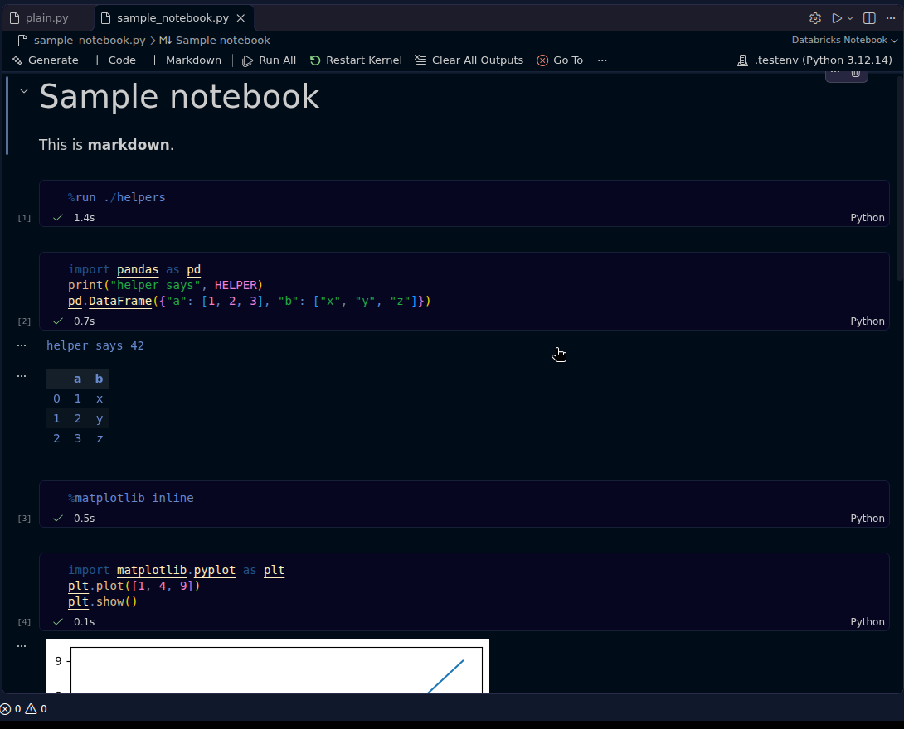
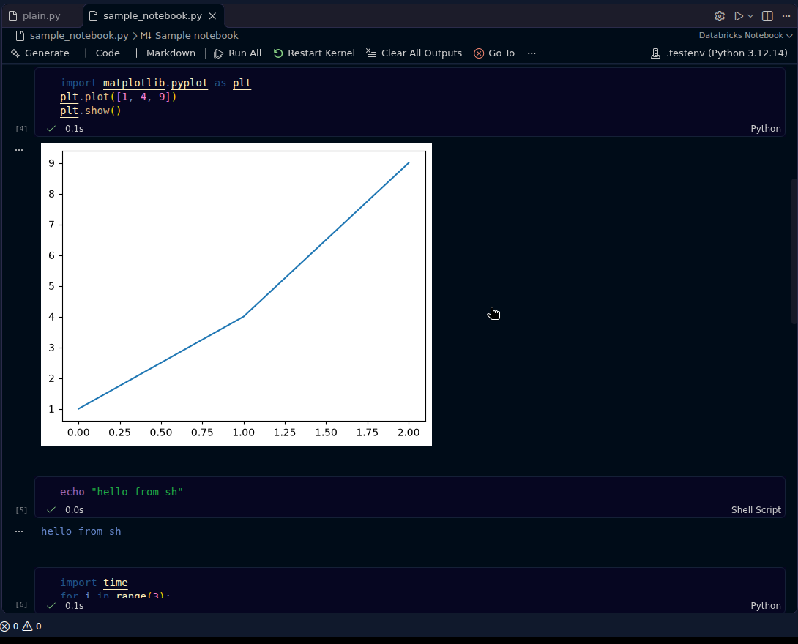
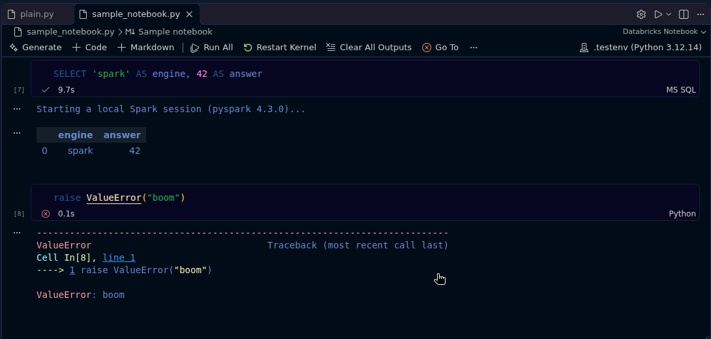

# Databricks Notebooks

Open Databricks source notebooks — `.py` files whose first line is `# Databricks notebook source` — in VS Code's notebook editor (the same editor the Jupyter extension uses) and run cells on a **local** Python kernel. No Databricks connection is needed.



## Features

- `.py` files with the Databricks header open as notebooks automatically. Other `.py` files are left alone.
- Cells split on `# COMMAND ----------`. `%md` cells show as Markdown, `%sql` / `%sh` cells get their own language, `# DBTITLE` titles are kept.
- Run cell / Run All / interrupt / restart, execution counts and timings, as in Jupyter. An error stops Run All.
- Outputs come from a real ipykernel, so they look the same as in Jupyter: stdout/stderr, pandas HTML tables, matplotlib plots, coloured tracebacks, `display(...)`, progress bars.
- Saving writes the normal Databricks source format back to the file, so it still imports into Databricks and diffs cleanly in git. Outputs aren't saved, because the format has no place for them.
- Kernel picker: lists your Python environments (through the Python extension), labelled like Jupyter's. Without the Python extension it uses `databricksNotebook.pythonPath`.



### Databricks magics and helpers, locally

- **`%sql`** cells run as `_sqldf = spark.sql(...)` followed by `display(_sqldf)`, and the result shows as a table. If a cell has several statements, each one runs and only the last result is shown.
  - `spark` is always defined. If pyspark is installed (it needs Java 17+), a local session starts the first time `spark` is used.
  - To run against a real cluster instead, set `databricksNotebook.spark` to `databricks-connect`.
- **`%run ./other_notebook`** runs that notebook's cells in the same namespace.
- **`%sh`** runs bash (PowerShell on Windows). **`%pip install …`** works as usual.
- **`display(df)`** works for pandas and for Spark DataFrames (it shows the first 1000 rows). `displayHTML(html)` also works.
- **`dbutils`** is a local stand-in:
  - `widgets.text/dropdown/get` keep values in memory.
  - `fs.ls/head/put/cp/mv/rm/mkdirs` work on local paths.
  - `secrets.get(scope, key)` reads the env var `DBX_SECRET_<SCOPE>_<KEY>`.
  - `notebook.run/exit` are supported.
- Scala and R cells are kept and saved correctly, but they can't run locally.



## Requirements

- The Python you select for the kernel needs `ipykernel` and `jupyter_client`: `python -m pip install ipykernel jupyter_client`. If they're missing, the extension offers to install them.
- Optional, for `%sql` / `spark`: `pip install pyspark` and Java 17+.
- Recommended: the [Python extension](https://marketplace.visualstudio.com/items?itemName=ms-python.python), so the kernel picker can list your environments.

## Commands

- **Open as Databricks Notebook**: from the explorer right-click menu, the editor title bar, or the command palette.
- **Open as Python Text File**: also on the notebook toolbar. Use it to edit the raw source.
- **Restart Kernel**: also on the notebook toolbar.
- **New Databricks Notebook**
- **Show Kernel Log**

## Settings

- `databricksNotebook.autoOpen` (default `true`): open Databricks `.py` files as notebooks automatically.
- `databricksNotebook.pythonPath`: the interpreter to use when the Python extension isn't installed.
- `databricksNotebook.spark`: `auto` (the default: start a local session on first use) / `none` / `local` / `databricks-connect`.
- `databricksNotebook.startupCode`: Python code that runs silently every time a kernel starts.

## Development

```
npm install
npm run test:unit                       # parser round-trip tests
python test/driver_test.py              # kernel bridge against a real ipykernel
xvfb-run -a npm run test:integration    # real VS Code: open, run, save a notebook
npm run package                         # -> .vsix
```

Releases are published from GitHub Actions when a `v*` tag is pushed (Marketplace Trusted Publishing, no stored tokens).

---

Not affiliated with or endorsed by Databricks, Inc. "Databricks" is a trademark of Databricks, Inc.
